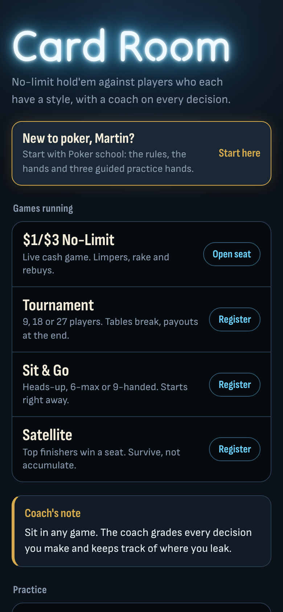
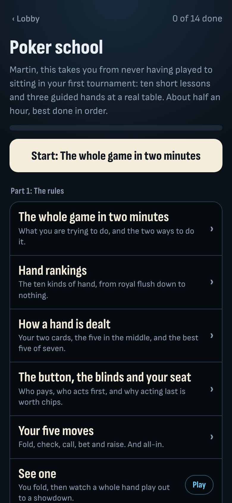
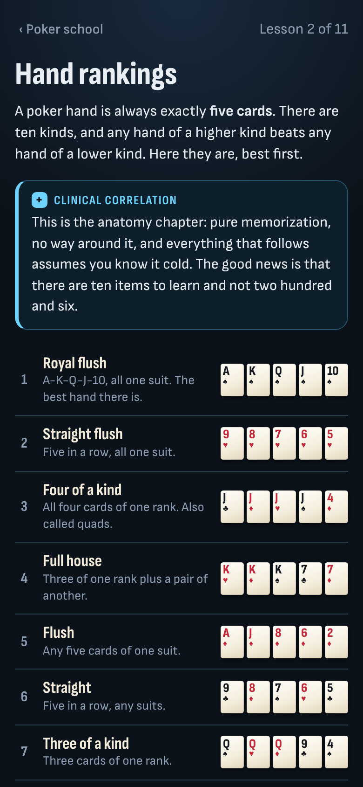
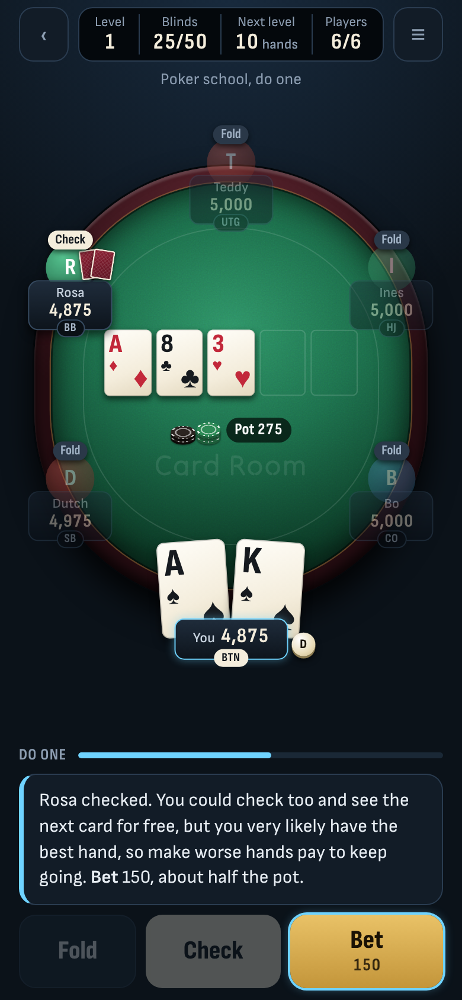

# Card Room

A no-limit Texas hold'em trainer that runs in the browser and installs on a phone like an app.
You play tournaments and cash games against opponents who each have a style, a coach grades every
decision you make, and drills isolate the spots that decide games.

It also includes **Poker school**: a complete course for someone who has never played, written for Martin.

<p>
  
  
  
  
</p>

## What is in it

- **Games.** $1/$3 cash, multi-table tournaments (9, 18 or 27 players), Sit & Gos (heads-up, 6-max, 9-handed) and satellites.
- **A coach on every decision.** Each move is graded Solid, Close or Leak with the reasoning: ranges, equity, pot odds and, near the money, ICM. Ask before you act, undo and try the other option.
- **Drills.** Nine kinds, from "what do you have?" to bubble decisions.
- **Range charts.** Opening, push/fold and calling ranges, plus a range builder with equity.
- **Your numbers.** Bankroll, results by format, and accuracy by kind of decision.

## Poker school

Open the app and tap **New to poker, Martin?** on the lobby. The course takes about half an hour:

1. **The rules**: the goal, hand rankings, how a hand is dealt, the button and blinds, and the five moves.
2. **Two guided hands** at the real table. In "See one" you fold and watch a hand to showdown; in "Do one" you raise ace-king and bet it for value.
3. **Playing well**: which hands to play from which seat, outs and pot odds, a third guided hand where the price of a draw changes, reading opponents, and tournaments.
4. **On your own**: a tour of the table screen, then a first real game against soft opponents with the equity hint switched on.

There are short quizzes along the way, two beginner drills ("What do you have?" and "Who wins?") and a glossary.

Where a medical comparison really fits, or is at least funny, a lesson has a short
**Clinical correlation** aside: reading a range as a differential diagnosis, pot odds as risk and benefit.
They are garnish, and the course reads fine without them.

To teach somebody else, change `STUDENT` at the top of `src/tutorial/lessons.js`.

## Run it

It is a static site with no build step.

```sh
npm start        # serves the app at http://localhost:8080
```

Any static file server works too, for example `python3 -m http.server`. Opening `index.html`
straight from disk does not, because browsers will not load JavaScript modules from `file://`.

## Put it on a phone

1. Host the repository root anywhere that serves static files over HTTPS. With GitHub Pages:
   **Settings → Pages → Deploy from a branch →** `main`, folder `/ (root)`.
2. Open the address on the phone.
3. iPhone: **Share → Add to Home Screen**. Android: **⋮ → Install app**.

After the first visit it works with no connection. Progress, statistics and a game in progress are
saved in the browser on that device.

## How the code is laid out

```
index.html              the page
styles/app.css          all styling
sw.js                   service worker: the offline copy
manifest.webmanifest    name, colors and icons for the installed app
src/
  core/                 cards, the hand evaluator, ranges, equity, ICM. No game state.
  game/                 the table: dealing and betting (engine), opponents (bots), tournament and
                        cash bookkeeping (session), the coach, and drill generation
  tutorial/             Poker school content: lessons, the glossary, the scripted guided hands
  app/                  the interface: screens (views/), game flow, storage, sound
tests/                  node:test suites
scripts/                the dev server, and sync-sw (keeps sw.js in step with src/)
```

Everything in `core/`, `game/` and `tutorial/` runs without a browser, which is how the tests play
whole tournaments.

## Develop

```sh
npm install      # dev tools only: eslint and prettier
npm test         # 22 tests: evaluator, engine, coach, drills, course content, offline packaging
npm run lint
npm run format
npm run sync-sw  # after adding, removing or renaming a file in src/
```

Two things the tests guard that are easy to break:

- **The guided hands.** Each script is replayed through the real engine, checking whose turn it is at
  every step and the final result. If you change a script or the dealing code, the test tells you where
  they disagree.
- **Advice in the lessons.** Where a lesson names specific hands ("raise ace-four on the button"), the
  test checks the claim against the same tables the coach grades with, so the course and the coach
  cannot drift apart.

## Notes

- All chips are play money. Nothing here connects to a real-money game.
- The coach is a simplified model: solid fundamentals, not a solver.
